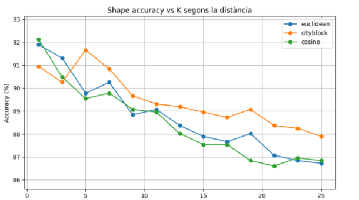

# Fashion Image Labeling — KNN + K-means

**Artificial Intelligence · Universitat Autònoma de Barcelona (UAB) · 2025–26 · Team project (3 students)**

A Python computer-vision project that assigns **garment-type labels** using K-Nearest Neighbors (KNN) and **dominant-color labels** using K-means clustering. The coursework also explores searching for products by **shape**, **color**, or a combination of both.

This repository presents the algorithms, selected experimental evidence, and a runnable synthetic-data demo. It is **not** a pretrained deep-learning model or a production e-commerce platform.

## Key components

| Component | Implementation | Purpose |
|---|---|---|
| Garment classifier | `KNN.py` | Grayscale image features, nearest-neighbor voting; Euclidean, Manhattan and cosine distances |
| Color clustering | `Kmeans.py` | RGB clustering, centroid initialization strategies, color naming, heuristic K selection |
| Retrieval & evaluation | `my_labeling.py` | Image filtering by shape/color, classification accuracy comparisons, clustering diagnostics |
| Demo | `demo.py` | Runs both algorithms on small synthetic images without downloading the course dataset |
| Tests | `tests/test_algorithms.py` | Independent synthetic tests covering classifiers, clustering and retrieval |

## My contribution — Jordi Tulleuda

In the team's final report, I was responsible for extending KNN with **Manhattan (`cityblock`) and cosine distances**, in addition to the original Euclidean metric. I also worked on **shape-based retrieval and quantitative shape-accuracy analysis** (`Retrieval_by_shape`, `get_shape_accuracy`), comparing odd K values from 1 to 25.

The group report concludes that **cosine distance at K=1 exceeded 92% shape-classification accuracy** in the reported experiment, while Manhattan distance was more stable for several larger K values. We chose **K=5 with Manhattan distance** for an illustrative shape-retrieval experiment because its neighbor votes provide more informative confidence scores.



*Figure: original team-report experiment; this is historical evidence, **not** a fresh benchmark of the GitHub package.*

The K-means extensions (additional centroid initializations, convergence controls and heuristic selection) and combined product retrieval were collaborative work, with improvements attributed to other team members in the submitted report. See [implementation and provenance notes](docs/implementation-notes.md).

## Try it locally

Requires Python 3.10+.

```bash
python -m venv .venv
# macOS / Linux:
source .venv/bin/activate
# Windows PowerShell:
# .venv\Scripts\Activate.ps1
python -m pip install -r requirements.txt
python demo.py
python -m unittest discover -s tests -v
```

`demo.py` uses **synthetic patterns and RGB color patches**. It verifies that the algorithms run, but is not a performance evaluation of real clothing images.

## Full course experiment

The original experiment uses the Fashion Product Images dataset, together with UAB-specific training/test splits and ground-truth JSON files. **The images and split files are not included in this repository.** The experimental entry point is:

```bash
# After placing the authorized dataset under images/ (see images/README.md):
python my_labeling.py
```

This complete analysis may take substantial time and opens multiple plots. Dataset details: [images/README.md](images/README.md).

## Project structure

```text
.
├── KNN.py
├── Kmeans.py
├── my_labeling.py
├── utils.py
├── utils_data.py
├── demo.py
├── requirements.txt
├── tests/
│   └── test_algorithms.py
├── assets/
│   └── knn-distance-comparison.png
├── docs/
│   └── implementation-notes.md
└── images/
    └── README.md
```

## Academic context and attribution

Built as part of the **Artificial Intelligence** course in the Computer Engineering degree at UAB, academic year 2025–2026. **Three-student group project**. Features developed collaboratively are described as team work; individual contributions are attributed only where supported by the final presentation/report and labeled code.

The publicly shared version omits student ID numbers, proprietary quiz fixtures and the image dataset. Before publication, confirm permission to redistribute the UAB starter utilities and collaborative material. No license has been added on behalf of collaborators.
